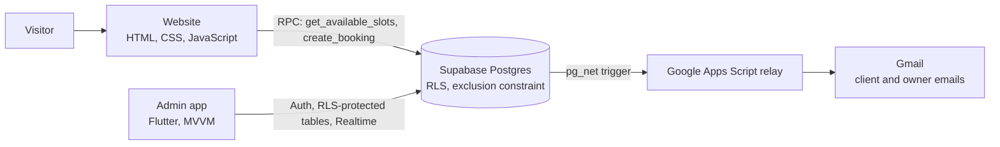

# SL Digital Works: booking website and admin app

A complete booking system for a freelance design and development business: a public website where clients book a session, a private admin app where the owner manages everything, and one shared Supabase backend behind both.

**Live website:** https://sldigitalworks.netlify.app   
**Admin app:** https://sldigitalworksmanagentapp.netlify.app (login required)  
**Demo video:** https://drive.google.com/file/d/1LZkll-nkY_fdDpm49kZnlOrXcARxIrG3/view?usp=sharing

> Concept project by Sibusiso Lukhele. The design is in Figma:(https://www.figma.com/design/S3TMmuCV25Zc0j0fK2OU5G/SL-Digital-Works-Designs?node-id=3-4&t=byHKM8bkh8Oa4Seh-1)

## What it does

**Website (visitors)**
- Browse services loaded live from the database
- Four-step booking flow: service, date and time, details, confirmation
- Only genuinely free times are offered, shown in South Africa time (SAST)
- Handles loading, no availability, validation errors, connection errors and "that time was just booked"
- Confirmation email to the client, notification email to the owner

**Admin app (owner)**
- Secure sign-in, restricted to admin accounts
- Bookings list that updates live when someone books
- Calendar view with a day panel
- Confirm, complete or cancel a booking (the client is emailed on confirm and cancel)
- Client list with search, booking history and private notes
- Add, edit, hide or show services
- Time off: holidays, leave and appointments, plus weekday lunch breaks

## Architecture

| Part | Tech |
|---|---|
| Website | Plain HTML, CSS and JavaScript calling Supabase's REST API with `fetch`. Hosted on Netlify |
| Admin app | Flutter (web build deployed on Netlify), MVVM with Provider, `go_router`, `supabase_flutter`, `table_calendar` |
| Backend | Supabase: Postgres, Auth, Row Level Security, Realtime, `pg_net` |
| Email | Database trigger calls a Google Apps Script web app that sends from Gmail |
| Uptime | A scheduled GitHub Action pings the API so the free-tier project is not paused |

## Design decisions worth reading

1. **Double-booking is prevented by the database, not the interface.** A Postgres exclusion constraint on time ranges means two overlapping bookings cannot exist, even if two people click at the same instant. The site then shows a friendly "that time was just booked" message.
2. **The public site never touches the bookings table.** Visitors can only call two functions: one that returns free slots, one that creates a booking. Everything else is locked behind Row Level Security and an `admins` table.
3. **Availability is data.** Opening hours, a slot interval, minimum notice and booking window live in tables. Lunch breaks and days off are blocked-time rows, so the owner changes them from the app with no code changes.
4. **Slot start times and session length are separate.** Hourly starts, but a 90-minute session blocks the whole 90 minutes, and automatically hides any start that would run into lunch.
5. **Emails never block a booking.** The trigger swallows errors, so a failed email cannot lose a booking.
6. **Clear MVVM structure in the admin app.** Views draw the screen, view models hold state and logic, repositories are the only code that talks to Supabase.

## Setup

1. **Backend:** follow [`supabase/README.md`](supabase/README.md).
2. **Website:** put your project URL and publishable key at the top of `web/app.js`, then deploy the `web/` folder to any static host.
3. **Admin app:** follow [`admin/README.md`](admin/README.md).
4. **Emails (optional):** deploy `supabase/email_relay.gs` as described in `supabase/README.md`.

## Security notes

- Row Level Security is on for every table. Anonymous visitors can read active services, opening hours and settings, and call the two booking functions. Nothing else.
- The publishable key is designed to be public; it is only safe because of RLS. The `service_role` key is never used anywhere in this project.
- Booking functions validate input on the server and never update an existing client's details.
- Private values (email webhook URL and secret) live in a table with no public access.
- Public sign-ups are disabled; only manually created users can sign in, and only those listed in `admins` get access.

## Known limitations

- Single provider: one booking at a time (the exclusion constraint would take a `staff_id` for multiple staff).
- Bookings do not store the price they were made at, so changing a price changes it on past bookings in the admin app.
- Blocking time does not cancel bookings that already exist in that period.
- Clients cannot cancel or reschedule themselves yet; they reply to the email.
- No online payment: payment is arranged after booking.
- Gmail's sending limit (about 100 emails a day) caps email volume.
- No automated tests yet. Behaviour was verified by hand end to end.

## Roadmap

Website reviews and testimonials, time-off shown on the calendar, a "reinstate booking" action, day-before reminder emails, and a client self-service link to cancel or reschedule.
